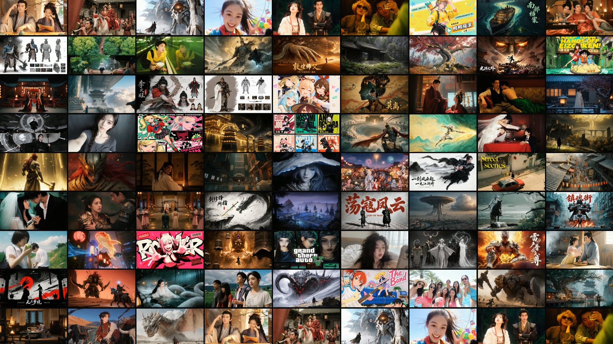
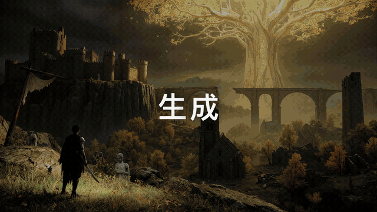
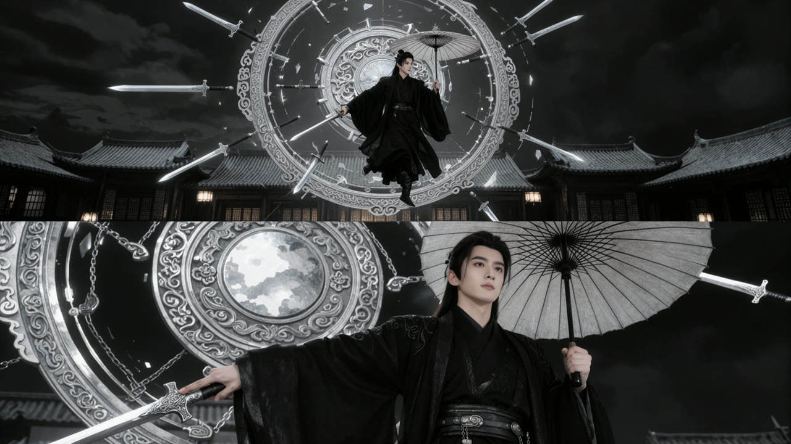
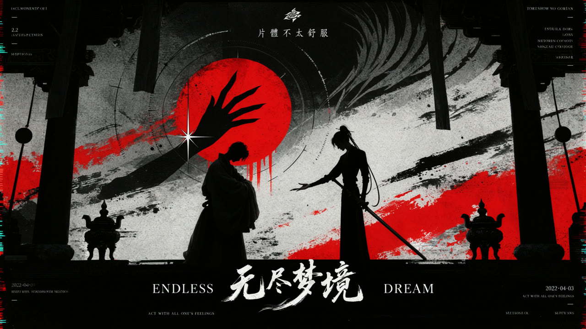
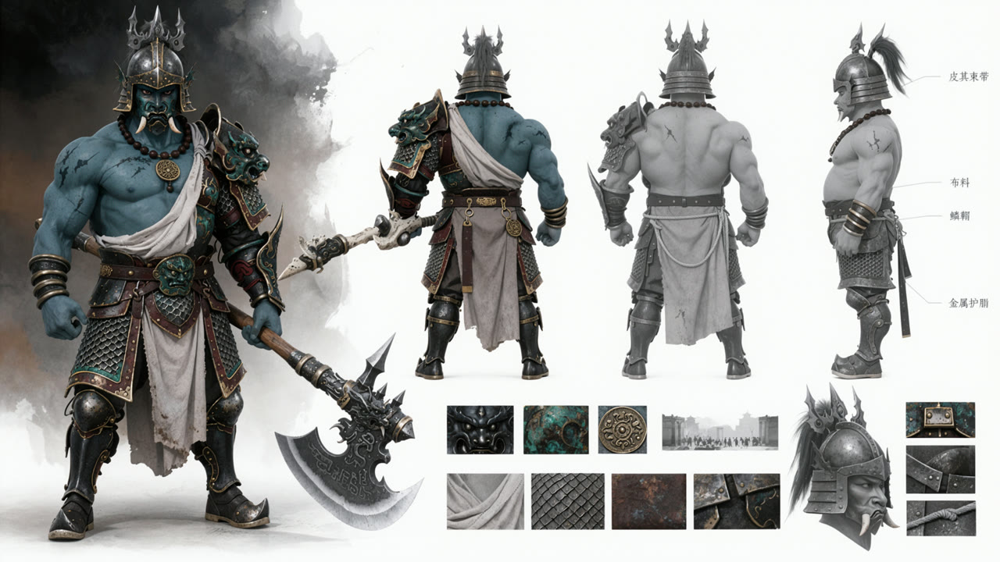

<div align="center">

# FISHER MOSS · Prompt Expander

**一句画面想法，展开成可以直接使用的详细提示词。**

中文 SKILL · ComfyUI 英文 Caption 模板 · 图像与提示词配对案例

[快速开始](#快速开始) · [案例画廊](docs/gallery.md) · [完整文档](docs/fisher-moss-prompt-expander-完整版.md) · [下载发布包](https://github.com/Work-Fisher/fisher-moss-prompt-expander/releases/latest)



</div>

## 先看效果

[](https://github.com/Work-Fisher/fisher-moss-prompt-expander/releases/download/v1.0.0/intro.mp4)

**[观看 / 下载 58 秒片头演示（1080p MP4）](https://github.com/Work-Fisher/fisher-moss-prompt-expander/releases/download/v1.0.0/intro.mp4)** · [仓库内视频](assets/intro.mp4)

封面与片头由作者提供。动态预览为片头节选，完整视频保留原时长与音轨。

## 选一个适合你的入口

| 你要做什么 | 使用哪个文件 | 输出 |
|---|---|---|
| 在支持 Skills 的 Agent 中，把一句话或参考图展开 | [fisher-moss-prompt-expander](skills/fisher-moss-prompt-expander/SKILL.md) | 默认详细中文提示词；自由创作约 1500—2500 汉字 |
| 在 ComfyUI 的文本扩写节点里直接使用 | [ComfyUI 精简执行模板](templates/MOSS-Image_ComfyUI扩写提示词.md) | 英文 Caption，指定画面文字保留原语言 |
| 阅读完整方法与案例 | [SKILL 完整单文件 MD](docs/fisher-moss-prompt-expander-完整版.md) | 规则、六篇长案例、局部模块和验收记录 |
| 研究 Caption / Layout 和编译流程 | [MOSS-Image 完整参考模板](templates/MOSS-Image中文提示词扩写模板.md) | 改编模板、案例与上游编译器附录 |

本项目负责生成**提示词文本**，不自动调用生图服务。名称中的 MOSS 为项目命名；这是社区整理与改编项目，并非 OpenMOSS 官方插件。

## 快速开始

### 方式一：安装 SKILL

下载仓库或发布包，将 `skills/fisher-moss-prompt-expander` 整个目录复制到你的 Agent 的技能目录。Codex 通常使用 `~/.codex/skills/`，重新打开会话后调用：

```text
使用 $fisher-moss-prompt-expander：
两个女生在咖啡店喝咖啡，然后手持自拍。
```

默认返回可复制的中文提示词代码块。指定“简短、200 字以内”即可切换短版；提供参考图时，以画面证据优先，不为了长度编造遮挡细节。

### 方式二：ComfyUI 模板

1. 打开 [ComfyUI 精简执行模板](templates/MOSS-Image_ComfyUI扩写提示词.md)，复制全文到文本扩写节点的 `system_prompt`。
2. 将中文画面需求放入该节点的用户输入字段（例如 `custom_prompt`；以所用节点为准）。
3. 把生成的英文 Caption 接入图像生成的正向提示词。

此仓库不包含 ComfyUI 自定义节点，也不要求安装同名节点。完整参考模板包含源码附录，体积较大，不应整份塞进小上下文节点。

## 精选画廊

点击图片查看对应的**图像生成提示词原文**。展示图已压缩，未携带原 PNG 的工作流元数据。

| 日常肖像 | 双人互动 | 多人群像 |
|:---:|:---:|:---:|
| [](examples/case-011.md) | [](examples/case-079.md) | [](examples/case-024.md) |

| 建筑与环境 | 巨物与法相 | 剑阵与特效 |
|:---:|:---:|:---:|
| [](examples/case-073.md) | [](examples/case-062.md) | [](examples/case-061.md) |

| 水墨海报 | 时尚摄影 | 角色设定板 |
|:---:|:---:|:---:|
| [](examples/case-021.md) | [](examples/case-081.md) | [](examples/case-067.md) |

**[浏览全部 12 组精选图与提示词 →](docs/gallery.md)**

这些是项目已有生成图及其实际提示词配对，不能视为新版 SKILL 的统一对比实验。六篇教学长案例和这些图像配对案例是两套不同用途的材料。

## 怎样把一句话展开


- **先把关系说清楚**：谁站在哪里，谁拿什么，手与物体如何接触。
- **按题材展开**：日常自拍、双人互动、多人群像、环境、巨物、特效、海报与设定板使用不同重点。
- **细节彼此相容**：裁切决定哪些肢体可见，照明决定材料和反射，媒介决定摄影或绘画语言。
- **支持特殊输入**：前置 / 镜面 / 第三方自拍，多图独立输出或指定融合，局部修改，多角色跨视图绑定。

## 案例与验证

SKILL 包含 6 篇完整长例（正文约 1591—2090 汉字）以及专项短模块。短模块示范局部难点，不是默认交付长度。

已执行结构与内部链接校验，并保留自拍、多人动作、水墨标题、参考图关系及双角色三视图等文本试跑记录。咖啡店自拍原稿与定向修订稿都保留，详见 [验收记录](skills/fisher-moss-prompt-expander/validation/README.md)。

并非所有分支都已实测；本次 SKILL 更新未进行指定目标生图模型的完整回归测试。字数是文本详尽度设置，不是模型的最佳输入长度；请按实际上下文容量使用。

## 目录

```text
skills/fisher-moss-prompt-expander/  可安装技能、规则与教学案例
templates/                         ComfyUI 模板与完整参考模板
docs/                              单文件完整文档与画廊
examples/                          每张展示图对应的原始提示词
assets/                            封面、动态预览、视频与展示图
```

## 来源与许可

由 **Work-Fisher** 整理。MOSS-Image 完整参考模板改编自 [OpenMOSS/MOSS-Image](https://github.com/OpenMOSS/MOSS-Image) 的提示词增强技能；上游快照与原文说明保留在模板中。

代码与适用的文本采用 [Apache-2.0](LICENSE)，上游归属见 [NOTICE](NOTICE)。演示图片、视频以及其中涉及的第三方角色、商标和肖像不包含在这项代码许可授权中。展示素材用于说明效果，不附带独立的商业使用授权。
