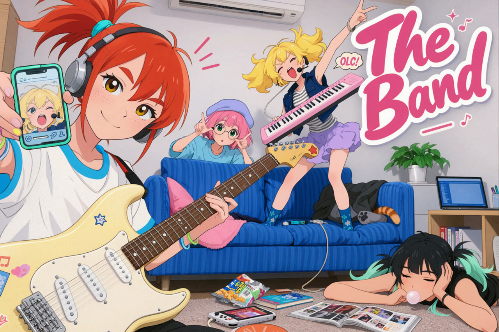

# 动漫插画



[返回画廊](../docs/gallery.md)

## 图像生成提示词原文

```text
一张日系少女乐队主题的彩色插画海报，参考青春音乐动画的角色表现与流行杂志封面设计。竖幅构图，镜头采用夸张但协调的广角透视，从房间前方近距离拍摄。四位外貌不同的少女散落在一间小型乐队休息室里，各自玩闹、唱歌、摆姿势或休息。前景人物与电吉他明显放大，后方沙发和人物依次缩小，形成充满生活气息的空间。画面以明亮色块、自然交叠和不同方向的动作组织节奏，不是整齐排列的合照。

前景左侧是一位漂亮活泼的橙红发少女，头部靠近画面左上方，身体延伸到左下角和底部。她的头发扎成蓬松高马尾，发束向上和两侧飞起，使用青蓝色发圈固定。她有明亮的金棕色大眼睛、自然红眉、鼻梁附近浅浅的雀斑和淡粉色脸颊，嘴角轻轻上扬，看向镜头，表情亲切而有一点得意。她穿宽松白色短袖上衣，领口和袖口有鲜蓝色饰边，耳侧戴着银灰色头戴耳机，手腕上套着蓝色和浅绿色细手环。

她身前斜挎一把奶油黄色电吉他，琴身位于画面左下方，放大到占据明显面积，琴颈斜向中央延伸。吉他有乳白色护板、银色琴桥与拾音器、清楚的琴弦和几枚彩色贴纸，边缘呈圆润的漫画轮廓。她一只手扶住琴颈，手指自然落在指板附近，另一只手将青绿色手机举到镜头前，屏幕朝向观看者。手机里显示一张金发同伴张嘴唱歌的夸张特写，屏幕边缘有简化的小图标与进度条。手机、握持的手和吉他之间关系明确，保留真实可行的手指姿态。

右后方是一位精力充沛的金黄发少女，站在蓝色沙发的坐垫上。她的头发蓬松外翘，眼睛兴奋地闭起，嘴巴大张，戴着带小型话筒的耳麦，正在投入地唱歌。她穿灰白横条纹上衣、敞开的深蓝短马甲与淡紫色荷叶边短裙，脚上是蓝色花纹袜子。一只手臂高举过头，手指做出摇滚手势，另一只手托着一台粉红色便携键盘。话筒靠近嘴边，耳麦线在身旁形成轻松弯曲的弧线。人物身体略向一侧倾斜，但双脚与沙发坐垫保持清楚的支撑关系。

中央沙发后方是一位娇小的粉红短发少女，戴圆框眼镜，头上斜戴一顶浅蓝紫色软帽。她穿宽松浅蓝衬衫，身体藏在沙发靠背后，只探出头部、肩膀与双手。她将两只手伸到脸旁，做出俏皮的小手势，眼睛透过镜片看向前景同伴。她的动作幅度小，表情认真又好奇，与后方金发少女的大幅动作形成反差。

右下方地毯上躺着第四位少女，黑色头发的发尾染成薄荷绿，头发分成松散的小发束。她穿黑色无袖上衣，身体斜伏在地面，一只手撑着侧脸，另一只前臂搁在摊开的杂志旁。她半闭着眼睛，神情慵懒，嘴边吹起一个小小的浅色泡泡糖。她的姿态低而舒展，脸部朝向画面中央，没有参与后方热闹的演唱，却自然属于同一个朋友群体。

房间中央摆着一张钴蓝色条纹沙发，坐垫略微下陷，上面散放粉红抱枕、外套与几件小物。一条暖棕色猫尾从沙发一侧伸出，猫的身体大部分藏在衣物后面。地毯上有摊开的音乐杂志、彩色书册、打开的零食袋、便携游戏机和弯曲的连接线。右侧矮柜上放着打开的笔记本电脑与一盆绿植，屏幕只显示简化蓝色界面。背景是浅灰白墙面，上方露出一角壁挂空调，使空间像真实而普通的少女乐队活动室。

画面右上方安排大面积玫红色手写标题“The Band”，字形厚实、圆润、相互连写，带奶白色描边和轻微投影，随着房间透视略微倾斜。金发少女附近放置一个小巧白色对话气泡，内部写“OLC!”。标题周围点缀少量星形、短线和节奏符号，装饰避开人物面孔。标题、前景橙红头发、黄色吉他与蓝色沙发形成明确的色块呼应。

整体采用明快的当代日系商业插画配色：橙红头发、奶油黄电吉他、钴蓝沙发、玫红标题、薄荷绿点缀和大面积柔和白色。颜色饱满但不发荧光，阴影使用淡蓝灰、浅紫和暖褐色，保留明亮底色。人物皮肤呈温暖浅桃色，眼睛透亮，脸颊有轻柔红晕，五官漂亮而有个性。

绘画方式采用清晰流畅的深色轮廓线、简洁赛璐璐阴影与局部柔和渐变。头发分成富有弹性的块状发束，衣服以少量准确褶皱体现动作，乐器和电子设备保留关键结构，不追求照片级纹理。使用轻微纸张颗粒和细小的色块纹理，呈现印刷海报般温暖而清爽的质感。整个画面清楚可读，不使用摄影景深、镜头光晕或电影暗角。氛围青春、自由、搞怪，像乐队排练间隙的一次热闹玩耍，没有平台水印或界面按钮。
```
