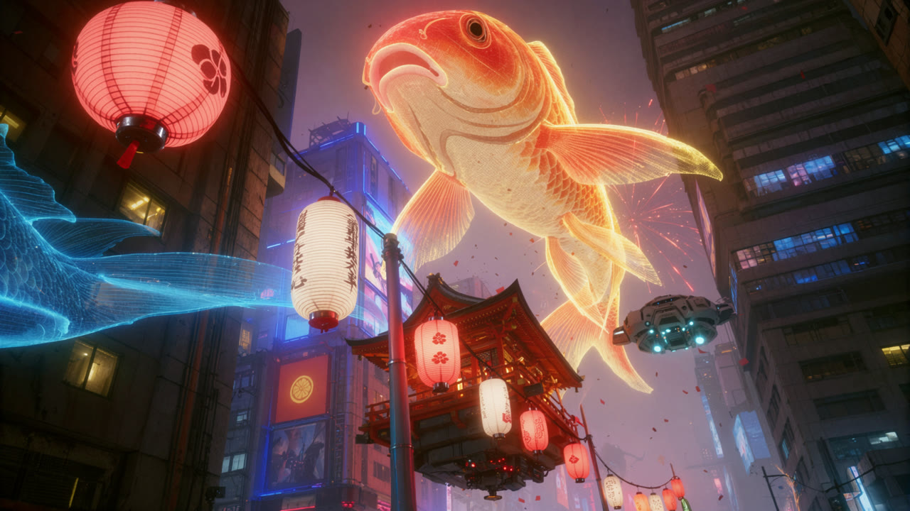

# 赛博全息



[返回画廊](../docs/gallery.md)

## 图像生成提示词原文

```text
赛博朋克未来都市的夜间祭典，置身高楼夹峙的狭窄街道，从行人视角大幅仰望天空，一条规模惊人的橙金色全息锦鲤游过建筑之间。传统日式灯笼、悬浮神社花车、密集霓虹招牌与工业化高层建筑交织，空气中飘着红色纸屑和细碎光点。整体具有《赛博朋克2077》式未来都市祭典的视觉气质，炽热的朱红与橙金光线穿过蓝紫色夜雾，营造喧闹、华丽而略带压迫感的城市奇观。

横向宽银幕画幅，采用广角镜头和强烈的低机位仰拍，视线从街道向上倾斜，镜头带轻微侧倾。左右高层建筑从画面边缘向天空中心收拢，夸张的透视形成狭长的城市峡谷。画面下方几乎不展示地面，以近处灯笼、立杆、悬浮建筑和高楼立面层层叠加。主体巨型锦鲤占据上方中央，头部接近画面顶部，身体向右下方弯曲延伸，明亮的鱼鳍与尾部穿过建筑之间。天空被建筑切割成不规则的灰紫色缝隙，进一步突出全息鱼的巨大尺度。

全息锦鲤的头部宽厚圆润，嘴部朝向画面左上方，圆形鱼嘴微张，从下方能看见嘴缘、下颌和弧形腹部。头顶呈鲜亮的橙红色，额头与轮廓边缘泛出金黄高光。鱼身由半透明的暖色光层构成，弧形鳞片若隐若现，轮廓清楚，内部可以透见部分城市背景。鱼头和上半身拥有足够体积，亮度集中于外缘与鳞片接缝，像由精密投影生成的巨型发光生物。

锦鲤长长的胸鳍、腹鳍和尾鳍舒展在空中，纤细的鳍条形成金色与橙黄色光丝，沿游动方向拖出柔软曲线。右侧巨大的扇形鱼鳍向外张开，密集鳍条呈放射状排列，边缘明亮，内部半透明。后方还有弯曲上扬的尾部光影，局部与蓝色全息光丝叠加。鱼体的不同部分通过遮挡和亮度区分，保持完整的游动姿态。全息投影具有细微扫描纹、像素闪烁和光线分层，但整体仍能清楚辨认锦鲤的头部、躯干、鳞片和飘逸鱼鳍。

画面左侧有另一组电蓝色全息鱼体或长鳍局部经过，主体大部分位于画外，只留下宽阔的蓝色发光轮廓和大量向左展开的流线。蓝色鳍条从左侧边缘横向伸入，与上方橙金锦鲤形成冷暖交错。近处红灯笼遮住其中一部分，蓝色投影则照亮后方建筑的局部结构，让全息生物像正在穿行街巷，而不是孤立贴在天空中的图案。

最靠近镜头的一盏红色圆灯笼位于画面左上区域，体积明显大于其他灯笼。灯笼由弧形骨架撑起，纸面透出珊瑚红与粉橙色内光，深红色经纬骨架清楚可见。灯笼上有简洁的深色花纹或徽记，下端连接金属色底座与短红色垂饰。由于距离镜头较近，灯笼呈现鲜明的仰视形变和立体感，成为前景最醒目的实体物件。

一根深色悬挂线缆从左侧灯笼附近斜穿画面，连接中央立杆，再向右下方延伸。线缆上悬挂红色球形灯笼和乳白色长筒灯笼，灯笼随透视逐渐缩小，形成从左上前景通往右下远处的连续节奏。中央偏左的一盏白色长筒灯笼高度突出，细密横向骨架贯穿灯罩，表面有竖向深色日式书法，底部收束成红褐色圆盖。其余白灯笼带有暗红色几何花纹与少量装饰文字，红灯笼则以简单深色图案为主。文字属于实物灯笼装饰，沿纸面曲率自然弯曲。

灯笼之间保持不同距离和轻微朝向差异，近处灯罩纹理清楚，远处逐渐融入红金色光点。支撑灯笼的立杆从画面下方伸起，呈深灰金属色，杆身受到红色和蓝色灯光的两侧照射。线缆与立杆清晰穿过全息鱼的前方，通过实体遮挡关系建立空间深度。

中央偏下是一座悬浮于街道上方的日式神社花车，深红木构架托起宽阔的传统坡屋顶，屋脊和檐口轮廓清楚。建筑以斜侧面呈现，屋顶向画面右上方抬升，底部离地悬空。木柱、栏杆与檐下横梁构成紧凑而精细的传统结构，表面受到周围橙红光照射，暗部保持深棕黑色。花车底部是厚重的工业悬浮平台，带有少量红色灯点、机械模块和阴影中的支撑结构。传统神社上部与未来机械底座结合，整座花车从高楼之间缓缓经过，部分被前景灯笼遮挡。

街道两侧的高楼高耸密集，建筑立面由暗色混凝土、金属框架、玻璃窗、外露管道和广告牌组成。左侧楼体非常接近镜头，大面积处于阴影中，零散窗户透出暗黄灯光。中下方有一块竖向红色广告牌，中央是发亮的金黄色圆形徽记，下方嵌有图像广告。楼体上部受到蓝色全息投影照亮，形成沿结构边缘流动的冷光。建筑表面带有城市使用痕迹，材质粗糙、层次繁复，避免洁净统一的未来建筑外观。

右侧是一栋深灰褐色高层建筑，横向楼层分隔和矩形窗格向高处密集延伸，部分窗户发出冷蓝色光。建筑外墙上嵌有尺寸不一的电子广告屏，内容保持次要，不抢夺锦鲤主体。右侧中部可见一艘小型悬浮飞行器的底部，灰白色装甲外壳呈紧凑的多边形结构，底部几个推进器发出明亮的青白色光。飞行器略微倾斜，从建筑前方穿过，与巨型全息锦鲤形成尺度对照。

天空与楼宇间充满薄薄的蓝灰色、灰紫色城市烟霾，远处高楼边缘被雾气软化。红色纸片、深色小碎屑和零星发光颗粒散落在空气中，大小随距离变化，部分停留在清晰焦平面，部分因飘动形成短促拖影。锦鲤右后方有一圈放射状的红金色短光迹，像祭典烟花在雾中绽放，与鱼鳍的细长金色光丝区分开来。空气具有节庆活动中的流动感，画面捕捉投影、飞行器、花车和纸屑同时经过的一瞬间。

整体光色以高饱和橙金、朱红、电蓝和蓝紫为主。巨型锦鲤是最强光源，金白色边缘带有明显泛光，橙红色散射光照亮附近烟雾、屋顶和建筑表面。灯笼提供较柔和的暖红色局部照明，蓝色全息鱼与飞行器推进器在阴影中补充冷色亮点。暗部深沉，楼体保留黑褐与深蓝层次，亮部允许轻微溢出，但仍能辨认灯笼骨架、鱼鳞和鳍条。广角透视、体积雾、半透明全息材质和适量镜头光晕共同形成沉浸式游戏电影画面，视觉信息丰富，主体清楚，保持街头仰望巨型空中祭典的震撼感。无游戏任务提示，无小地图，无生命值，无物品栏，无字幕，无界面边框，无水印。
```
