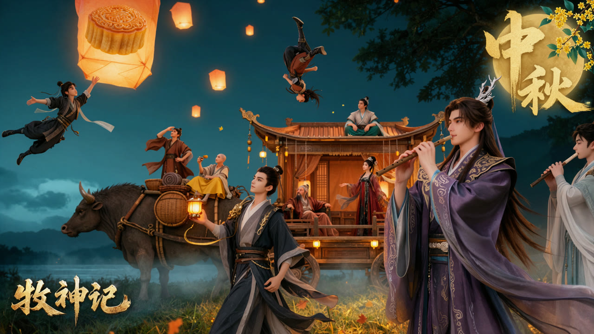

# 节日群像



[返回画廊](../docs/gallery.md)

## 图像生成提示词原文

```text
东方玄幻国风三维动画中秋群像海报，深青蓝色夜空下，一群造型各异的修行者围绕一辆由巨兽牵引的古典楼阁车欢聚。橙金色孔明灯从草地与水岸上空缓缓升起，夸张放大的金黄月饼悬在左上角，数名人物在空中腾跃嬉戏。右侧近景是一位长发紫衣青年吹奏竖笛，中央青年提着温暖的小灯行走，后方同伴或坐在车顶，或站在巨兽背上，或倚坐车厢。画面将仙侠人物的飘逸、旅途伙伴的亲近与中秋夜游的温暖融合，具有精细国漫角色渲染与节庆宣传插画的完整度。

横向宽幅海报构图，人物与车队集中在下半部和右半部，上方左侧保留大面积夜空，用孔明灯和腾空人物填出轻盈的节奏。右侧近景紫衣人物体量最大，占据画面高度约三分之二，中央提灯青年略小，巨兽与楼阁车横贯中景，车顶与远处人物再次缩小。构图沿着左侧巨兽、中央青年、右侧吹笛者逐层向前推进，同时由孔明灯串联上下空间。上方的空中人物姿态活泼，下方车队稳定厚重，形成动静结合的群像关系。

画面右侧前景是一位俊美的年轻成年东方男子，侧身朝向画面左侧，头部略微抬起，目光望向同伴与空中灯火。面容精致，神情温柔从容，棕黑色长发半束，头顶佩戴小巧的银色枝角状发饰，其余长发顺着后背向右侧飘散。身穿深紫、烟紫与墨蓝相间的层叠长袍，领口和胸前有繁复而细致的金色刺绣，袖口宽大，衣缘装饰连续的浅金纹样。长袍在腰部收束，下摆向画面右下方大幅铺展，形成舒展的弧线，局部超出画幅。

紫衣男子双手分置在一支细长的棕金色竖笛上，笛身从嘴边斜向左下延伸，一只手靠近上端，另一只手放在下方，手指自然按住笛孔，双肘低收。暖色灯光照亮他的侧脸、手指、衣领与胸前刺绣，后方头发和衣袖暗面带有冷蓝色夜光。人物表现为精致三维动画角色，皮肤柔和细腻，五官清晰，衣料具有真实厚度与丝绸反光，同时保留国漫理想化的俊美比例。

中央偏左的前景是一位年轻成年东方男子，身穿灰白内衫与深蓝黑色长袍，腰间束着宽腰带和层叠布带，肩胸处斜搭金色装饰。他一脚向前迈出，身体略向画面右侧转动，抬头望向上方，神情好奇而放松。黑发整齐束起，面容年轻清俊。画面左侧的手抬在腰胸之间，托举一盏小巧明亮的金色手灯，另一只手自然垂放于身侧。灯光映亮手掌、袖口与胸前织物，身体周围有细长金色装饰线条弯曲向上。袍摆和深色腰带向右后方扬起，带出缓缓行走的动态。

中景左侧是一头承担牵引与载物工作的巨大牛形异兽，头部朝向画面左侧，身体横向延伸至中央。异兽有深灰褐色皮肤、粗壮低垂的头部和明显的长角，身体披着宽大的鞍具与绳索，背上固定着竹篓、行囊、卷毯和旅行物资。大型圆形编织器物靠在鞍具侧面，竹木编织纹理清楚，边缘被灯光照成暖褐色。异兽的腿部部分被草丛、薄雾和前景人物遮挡，体量沉稳，作为承载伙伴与楼阁车的可靠坐骑。

异兽背上有两位同伴。靠左是一位身穿棕红色长衣的成年男子，站姿松弛，一只手抬至额前或面部附近，头微微后仰，另一只手扶在腰侧，衣摆顺着气流向后扬起。旁边坐着一位光头的成年同伴，身穿浅色上衣与明黄色宽裤，一手举起小巧食物或杯盏，姿态开朗。两人比例小于中央青年，表情和动作带有轻松的旅途气息，与前景吹笛者的安静形成呼应。

异兽后方连接一辆巨大的木构楼阁车，车厢像一座可以移动的小亭阁，深褐色木柱托起橙褐色弯曲屋顶，屋檐高高翘起，端部有龙首或兽形装饰。屋脊线条富有夸张的国风曲线，左右檐角向外延展，形成群像中央的重要横向结构。檐下悬挂细密珠帘、绳穗和暖色小灯，车内木地板、座椅、扶栏与布幔清楚可辨。底部可以看见车架与大轮子的局部轮廓，沿车厢边缘点缀金黄色灯火，使整辆车像移动的节庆亭台。

车厢中央坐着一位留有长须的年长男子，身穿暖红褐色衣袍，姿态舒展，手臂搭在身旁，安静观看伙伴。车厢右侧站着一位美丽的成年女子，穿深红与黑色相间的华丽长裙，发髻配有精致饰物，身边的薄纱和长袖向一侧飘起。她位于珠帘与暖灯之间，身形优雅，红裙与木构车厢的琥珀色光泽相互映衬。屋顶上另有一位身材结实的成年男子盘坐，浅色衣襟与青绿色下装清楚分区，双手自然放在身前或腿侧，神态自在。

画面最右侧边缘还有一位身穿浅色长袍的青年，身体受到画幅裁切，双手将一支横笛举至唇边，面向中央车队吹奏。浅色袖子在右侧暗部形成柔和亮面，与近景紫衣竖笛演奏者呼应。每位人物拥有独立服装配色、体态与道具，保持明确位置关系，避免将不同人物的乐器、发饰和衣袍混在一起。

左上方一位身穿深色旅行衣装的青年跃入空中，身体斜横，双腿屈伸，一只手向上伸向巨大的月饼，另一只手向侧方展开维持平衡。衣摆与束带在身后飘起，动作像在追逐节日食物，带有轻快幽默感。月饼呈温暖的金黄烘焙色，厚实圆形糕体的侧面有规则竖向纹路，顶部压着精致的传统花纹，表面略带油润高光。月饼尺寸有意夸张，明显大于人物头部，与写实细节结合形成节庆幻想。

天空中央偏右另有一名倒悬翻跃的人物，身体沿竖向弯曲，深色与棕红色衣料顺着动作散开。一只腿高高抬起，靴底朝向天空，头部与长发朝下，肢体关系清楚，呈现翻身腾空的瞬间。人物体量较小，位于楼阁车屋顶上方，身旁有细小飘散光点。空中动作保持轻盈与玩闹气氛，不带战斗攻击感。

孔明灯遍布天空，由左下近景向上方与远处逐渐缩小。最大的一盏位于上方偏左，橙黄色纸罩略呈不规则方筒形，薄纸被内火照得半透明，表面折痕和细微纤维隐约可见。底部火光最亮，向上过渡为柔和橙色。较近的灯笼拥有明显光晕，远处则变成小巧的暖色光点。各盏灯高低不同，疏密有致，保留足够夜空，不遮住主要人物面孔。

背景为深青蓝色湖岸夜景，低处有朦胧山林、水面与暗色树影。画面右上方伸出大树枝叶，形成深绿黑色的天然顶棚；左侧天空更加开阔，云层带有浅青色月夜微光。近地处有轻薄水雾，前景草地呈深绿与金褐相间的颜色，细草受到车灯照射后泛起温暖亮边。少量橙色落叶和细小金色光点飘过人物周围，增强秋夜气息。

右上角设置中秋主题装饰：一轮暖金色圆月作为底形，月面带有细腻纹理，其前方叠放大幅金色毛笔字“中秋”。两字上下错落，笔画有粗细变化与飞白，边缘如金箔般微亮。圆月旁点缀少量桂花枝、浅黄色小花与青绿色叶片，装饰集中在角落，不压住人物。左下角保留立体金色片名“牧神记”，字形具有古典篆隶与雕刻金属结合的厚重感，表面呈旧金与亮金交错的质感，文字尺寸适中，与右上角节庆题字共同平衡海报。

整体以深青蓝夜色为底，橙金孔明灯、暖褐楼阁车、紫色前景长袍和少量朱红人物衣饰构成丰富配色。暖光主要来自孔明灯、手灯与车厢灯火，冷色环境光描出头发、屋檐与衣料暗面的轮廓。角色皮肤光泽克制，发丝清楚，织锦和金属配饰拥有精致材质；背景雾气与远景适度柔化，前景人物和中景车队保持足够清晰。最终呈现华丽而亲切的国漫中秋群像宣传海报，强调伙伴相聚、旅途夜游、乐声与灯火。仅保留“中秋”和“牧神记”两组主题文字，不添加播出时间、平台标志、制作名单、竖排版权说明、水印或界面图标。
```
